<!-- animated 3D contribution skyline: real data, towers rise in a wave from the
     oldest week to the newest and settle again. Rebuilt daily by
     .github/workflows/update-skyline.yml (generator: scripts/render_skyline_svg.py) -->

<picture>
  <source media="(prefers-color-scheme: dark)" srcset="./skyline-dark.svg">
  
</picture>

